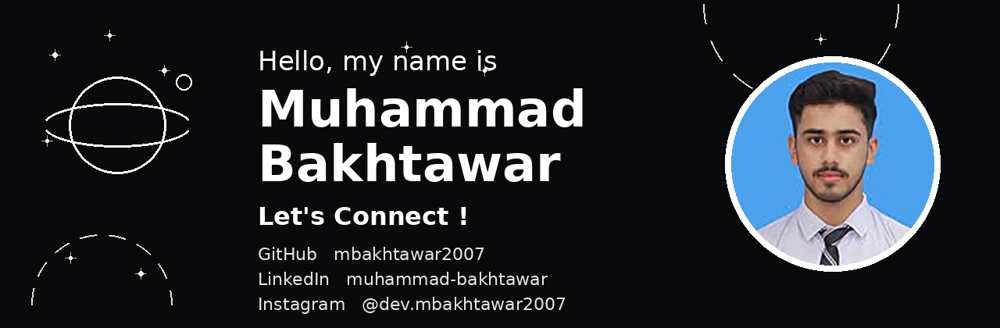

# Hi there 👋, Welcome!

Hello! 👋🏻 My name is Muhammad Bakhtawar. I am from Karachi, Pakistan, studying BSCS at Dawood University of Engineering & Technology (DUET). 🏫

I have a huge interest in full-stack web development 💻 as well as AI automation 🤖! Currently working with the MERN stack, Python and n8n, and building real products that solve real problems.

I love to join different communities and competitions that involve creating something useful for people! 🤟

**Skills:**
Full-Stack Web Development | AI Automation | REST APIs | Project Management

**Tools:**

  
  
  
  
  
  
  
  
  
  
  
  

- 🔭 I’m currently working on GreenKarachi, HCM Lite, and AICT projects
- 🌱 I’m currently learning advanced AI automation and workflow orchestration
- 👯 I’m looking to collaborate on real-world, full-stack projects
- 💬 Ask me about MERN stack, REST APIs, and AI automation with n8n and Python
- 📫 How to reach me: mbakhtawar2007 (GitHub, LinkedIn, Instagram @dev.mbakhtawar2007)
- 😄 Pronouns: He/Him
- ⚡ Fun fact: My name Bakhtawar means “fortunate” / “lucky”

### 💼 Featured Projects

- 🌱 **[GreenKarachi](https://greenkarachi.netlify.app/)** — B2B plant marketplace
- 👥 **[HCM Lite](https://hcm-lite.netlify.app/)** — AI-assisted HR system
- 🚀 **[AICT Group Portfolio](https://aictportfollio.netlify.app/)** — Team portfolio site
- 🎬 **[AICT Video Showcase](https://aict-video-showcase.vercel.app/)** — AI video showcase & voting

---

  
  
  
  
  

<i>✨ Open to collaboration and new opportunities.</i>

